# CSA C22.3 Overhead Line Design — Digitized Code Reference & Engineering Workflow App

**Detailed Plan & Product Specification**

| Item | Value |
|---|---|
| Discipline | Overhead transmission & distribution (T&D) line design — Canada |
| Primary standards | CSA C22.3 No. 1 *Overhead Systems*; CSA C22.3 No. 60826 *Design Criteria of Overhead Transmission Lines* |
| Secondary standards | CSA C22.3 No. 6, No. 7, CSA O15, CSA S16/S37/A23.3/O86, CSA C411.1, CSA C83, NBCC climatic data, ASCE 10/48, IEEE 738/524/80 |
| Audience | Line design engineers (EIT / P.Eng.), technologists, checkers, utility standards groups, software team |
| Status | Planning — v1.0 |

> [!CAUTION]
> **Copyright & licensing.** CSA standards are copyrighted by CSA Group. Reproducing clause text, tables or figures in a software product (even internally) requires an appropriate license (e.g., CSA Group enterprise/OnDemand licensing or a data/redistribution agreement). This plan assumes the organization holds or will obtain such a license. Where no license exists, the app must store **only clause IDs, paraphrased engineering intent, and user-entered values**, and deep-link to the official licensed copy.

> [!WARNING]
> **Verification required.** Clause numbers, table numbers and numerical values cited in this document are *indicative* and written from general practitioner knowledge across several editions (e.g., C22.3 No. 1-15 / No. 1:20, C22.3 No. 60826-10 and later). Every value marked **[VERIFY]** — and in practice every value — must be checked by a qualified SME against the edition adopted by the governing jurisdiction **before** it is loaded into the production code library.

> [!IMPORTANT]
> **Professional responsibility.** The app is a decision-support and productivity tool. It does not replace the engineering judgment of the P.Eng. who authenticates (stamps) the design. All outputs must be traceable, reproducible and independently checkable, consistent with provincial regulator guidance (EGBC, APEGA, PEO, OIQ, etc.) on the use of engineering software and documented independent checks.

---

## Table of Contents

1. [Executive Summary](#1-executive-summary)
2. [The CSA C22.3 Family & Regulatory Landscape](#2-the-csa-c223-family--regulatory-landscape)
3. [Functional Map — CSA C22.3 No. 1 (Overhead Systems)](#3-functional-map--csa-c223-no-1-overhead-systems)
4. [Functional Map — CSA C22.3 No. 60826 (Reliability-Based Design)](#4-functional-map--csa-c223-no-60826-reliability-based-design)
5. [The Engineer's End-to-End Workflow](#5-the-engineers-end-to-end-workflow)
6. [Core Engineering Calculation Library](#6-core-engineering-calculation-library)
7. [Automation Strategy](#7-automation-strategy)
8. [The Digitized Code ("Code-as-Data")](#8-the-digitized-code-code-as-data)
9. [The App — "LineDesk CA"](#9-the-app--linedesk-ca)
10. [System Architecture](#10-system-architecture)
11. [Verification, Validation & Quality Management](#11-verification-validation--quality-management)
12. [Roadmap & Delivery Plan](#12-roadmap--delivery-plan)
13. [Risks & Mitigations](#13-risks--mitigations)
14. [Appendices](#14-appendices)

---

## 1. Executive Summary

Canadian overhead line design is governed by the **CSA C22.3** series, which forms Part III of the Canadian Electrical Code and is adopted (directly or by reference, often with amendments) by provincial/territorial regulations. A line designer spends a large share of time on **non-creative, code-lookup and cross-checking tasks**:

- Identifying the loading zone, climatic parameters, return periods and construction grade.
- Translating code clauses into load cases for PLS-CADD / PLS-POLE / TOWER / SPIDAcalc / O-Calc.
- Looking up clearance tables and applying voltage adders, sag conditions and owner/jurisdiction overlays.
- Re-checking the same rules on every span, crossing and pole.
- Writing design criteria documents (DCDs) and calc packages with clause traceability.

This plan proposes two linked deliverables:

| Deliverable | What it is | Primary value |
|---|---|---|
| **A. Digitized Code Library** | A structured, versioned, searchable, machine-readable representation of C22.3 No. 1 and No. 60826 (clauses, tables, formulas, figures, definitions, cross-references) plus jurisdiction & utility overlays | Instant, correct, edition-aware lookup; the single source of truth that drives calculators and rule checks |
| **B. LineDesk CA (workflow app)** | A project-based application that follows the engineer's actual workflow — from scoping to issued-for-construction — with calculators, a criteria builder, a compliance engine, integrations and report generation | 40–60 % reduction in criteria/clearance/check effort (target), fewer non-conformances, consistent audit-ready documentation |

The key architectural idea is **"Code-as-Data → Rules-as-Code → Calcs-with-Trace"**: every number the app produces carries a citation back to the exact edition, clause and table row it came from.

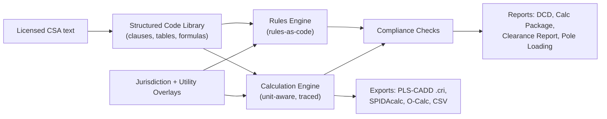

---

## 2. The CSA C22.3 Family & Regulatory Landscape

### 2.1 Standards in scope

| Standard | Title (short) | Role in line design | Priority for digitization |
|---|---|---|---|
| **CSA C22.3 No. 1** | Overhead Systems | Deterministic loading, clearances, separations, strength (overload capacity factors), grounding, guys, joint use. Governs most distribution and many transmission lines. | **P1** |
| **CSA C22.3 No. 60826** | Design Criteria of Overhead Transmission Lines (Canadian adoption of IEC 60826 with Canadian deviations/annex) | Reliability-based loading (wind, ice, combined), security (failure containment) and safety (construction & maintenance) loads; strength coordination; Canadian climatic data annex. | **P1** |
| CSA C22.3 No. 6 | Principles and practices of electrical coordination between pipelines and electric supply lines | AC interference, parallelism/crossings with pipelines | P3 |
| CSA C22.3 No. 7 | Underground Systems | Riser poles, transitions, dips | P3 |
| CSA C22.3 No. 3 / No. 8 / No. 9 | Electrical coordination / railway electrification / DER interconnection | Situational | P4 |

### 2.2 Companion standards the engineer constantly references

| Topic | Standard(s) |
|---|---|
| Wood poles | CSA O15 (classes, species, dimensions, fibre stress) |
| Steel poles / lattice | CSA S16, CSA S37, ASCE/SEI 48 (steel poles), ASCE 10 (lattice towers) |
| Concrete poles / foundations | CSA A23.3, CSA A14 (concrete poles), geotechnical references (e.g., CFEM) |
| Wood crossarms / timber | CSA O86, utility material specs |
| Insulators | CSA C411.1 (and IEC 61109/60383 equivalents) |
| Pole line hardware | CSA C83 |
| Climatic data | NBCC Appendix C (climatic design data), ECCC records, C22.3 No. 60826 Canadian annex |
| Ampacity / thermal rating | IEEE 738, CIGRE TB 601 / TB 207 |
| Sag-tension & conductor | Aluminum Association / Southwire data, CIGRE TB 324 (sag-tension), CIGRE TB 273 (vibration / H/w) |
| Grounding | IEEE 80, IEEE 524 (stringing), utility standards |
| Railway crossings | Transport Canada *Wire Crossings and Proximities Regulations*, railway company standards |
| Navigable waters | *Canadian Navigable Waters Act* (Transport Canada) |
| Aviation | Transport Canada CAR Standard 621 (obstruction marking & lighting), NAV CANADA land use submission |
| Pipelines | Canada Energy Regulator damage-prevention regulations, provincial pipeline acts |

### 2.3 Regulatory adoption (overlay concept)

The code itself is not automatically law; each province/territory adopts it by regulation, sometimes with amendments, and utilities frequently adopt stricter internal standards. The app must model **three layers**:

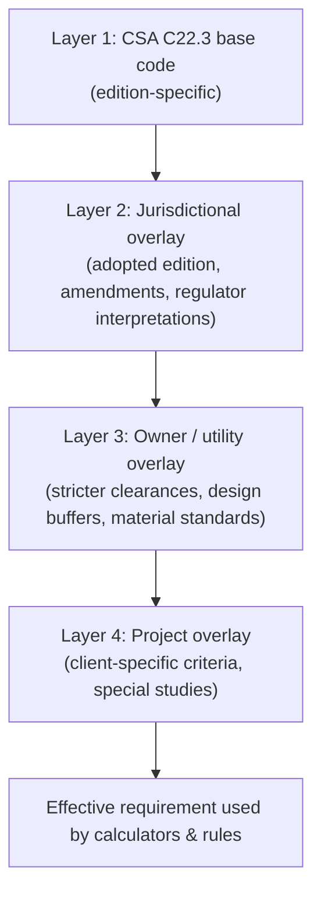

Examples to capture per jurisdiction (to be researched and verified by SMEs): adopted edition of C22.3 No. 1, whether No. 60826 is mandated for transmission above a given voltage, provincial safety-code amendments (e.g., Ontario Reg. 22/04 for distributors, Alberta Electrical Utility Code, BC Electrical Safety Regulation, Québec practice via Hydro-Québec standards), and authority-having-jurisdiction (AHJ) contacts.

> [!NOTE]
> The **effective requirement** is always the most restrictive applicable value unless an overlay explicitly *replaces* (rather than *adds to*) the base requirement. The data model in §8 supports both `mode: restrict` and `mode: replace`, with mandatory justification text.

### 2.4 Deterministic vs reliability-based design path

| Criterion | C22.3 No. 1 (Deterministic) | C22.3 No. 60826 (Reliability-based) |
|---|---|---|
| Typical use | Distribution, sub-transmission, many utility transmission lines | Transmission (typically higher voltage / critical lines), owner-mandated |
| Loading basis | Prescribed loading zones from map (e.g., Heavy, Medium A, Medium B, Severe… **[VERIFY]**) + temperature | Climatic return-period values (50/150/500 yr) from site data, terrain, height and span factors |
| Strength approach | Loads × **Overload Capacity Factors (OCFs)** ≤ rated/ultimate strength, by **construction grade** | γ_U · Q_T ≤ Φ_R · R_c with strength coordination |
| Extra cases | Unbalanced/longitudinal, deadend, angle; special loadings | Security (broken wire, RSL), safety (construction & maintenance), failure sequence coordination |
| Clearances | **Always C22.3 No. 1** (clearances/separations are not replaced by 60826) | Clearances still per No. 1 |
| Output | Load cases for structure design, sag-tension limits | Same, plus reliability documentation |

**Practical reality:** most Canadian transmission projects check **both** and adopt the envelope (governing) case; clearances and separations always come from No. 1 (plus overlays).

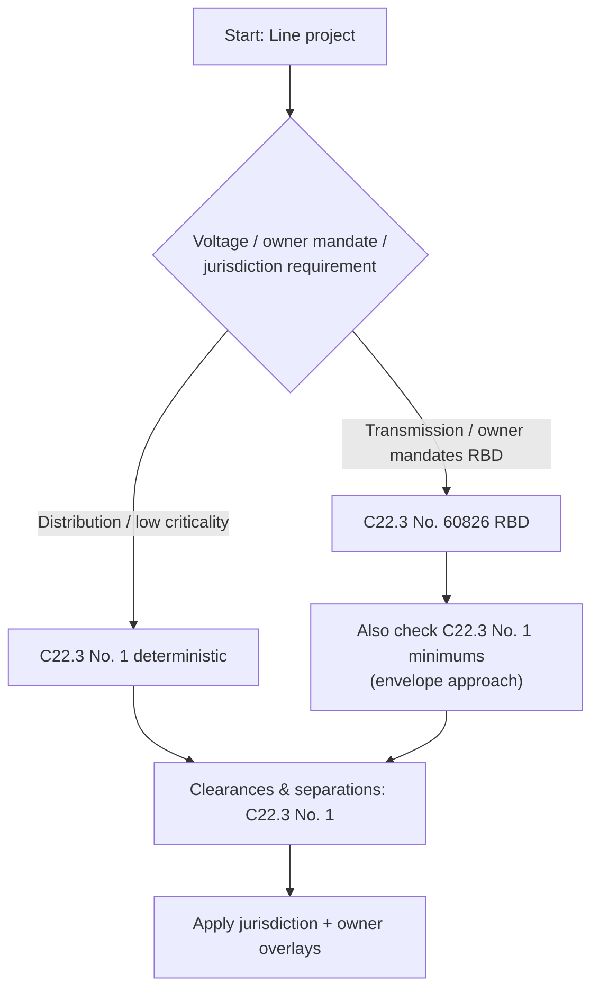

---

## 3. Functional Map — CSA C22.3 No. 1 (Overhead Systems)

Rather than reproducing clause text, the digitized library maps the standard into **functional topics**, each with the *inputs the engineer must supply* and the *outputs the code provides*. Clause numbering below is indicative **[VERIFY per edition]**.

| # | Topic area | Engineer's question | Code provides | Inputs needed | Output used in |
|---|---|---|---|---|---|
| 3.1 | Scope, definitions | "Does this apply? What does *supply conductor / communication line / structure / crossing* mean?" | Definitions, scope limits | Facility type | All |
| 3.2 | General requirements | "What are baseline obligations (accessibility, identification, materials)?" | General rules | — | DCD |
| 3.3 | **Vertical clearances above ground, rails, water** | "How high must conductors be over this road / field / rail / water?" | Clearance tables by voltage class and surface category; conditions of sag | Voltage, conductor type, crossing category, sag condition | Spotting, clearance report |
| 3.4 | **Clearances to buildings, signs, pools, bridges and other structures** | "How close can I be to this building/pool/sign, horizontally and vertically?" | Tables; wind-displaced conductor positions | Voltage, displacement (blowout) | Route & spotting |
| 3.5 | **Crossings & conflicts with other lines** | "What vertical separation is needed between my line and the line I'm crossing?" | Crossing tables by upper/lower voltage | Both voltages, temps, ice/sag | Crossing drawings |
| 3.6 | **Separations on same structure** | "Phase-to-phase, circuit-to-circuit, supply-to-communication spacing at structure and midspan?" | Tables + sag-dependent separation formula | Voltage, sag, span | Framing design |
| 3.7 | Clearance from conductors to structure / climbing space | "Do I have adequate climbing/working space and phase-to-structure clearance?" | Tables | Voltage, framing | Framing design |
| 3.8 | **Mechanical loading (loading map & conditions)** | "Which loading zone? What ice, wind, temperature?" | Loading map (figure), loading conditions table | Location | Load cases |
| 3.9 | **Construction grades & Overload Capacity Factors** | "Grade 1 or Grade 2? What OCF for vertical/transverse/longitudinal on wood/steel/concrete?" | Grade-selection criteria, OCF tables | Crossing type, voltage, material | Structure checks |
| 3.10 | **Conductor tension limits** | "Max allowable tension under loaded/unloaded conditions?" | Limits as % of rated strength | Conductor, condition | Sag-tension |
| 3.11 | **Strength of structures (wood, steel, concrete, composite)** | "Is my pole/tower strong enough with OCFs and deterioration?" | Strength requirements, replacement thresholds | Structure data | Pole/tower design |
| 3.12 | **Guys and anchors** | "Guy strength, anchor capacity, guy insulators, guarding?" | Strength factors, guy insulation rules | Guy layout, voltage | Guy design |
| 3.13 | Crossarms, pins, hardware | "Hardware strength factors?" | Requirements | Hardware ratings | Framing |
| 3.14 | **Insulators** | "Mechanical strength ratio, electrical rating?" | Strength factors vs rated loads | Insulator ratings | Insulator selection |
| 3.15 | **Grounding & bonding** | "What must be grounded, how, with what resistance/conductor?" | Grounding requirements | System type (multigrounded neutral etc.) | Grounding plan |
| 3.16 | **Joint use** (supply + communications) | "Can telecom attach? At what separation? Who loads the pole?" | Separations, climbing space, attachment rules | Attachment heights | Pole loading / attachment applications |
| 3.17 | Equipment on structures | "Transformers, switches, risers: clearances & support?" | Equipment mounting rules | Equipment data | Framing |
| 3.18 | Annexes (informative) | Explanatory methods | Background | — | Reference |

### 3.1 Example: C22.3 No. 1 loading conditions (structure of the data)

> [!WARNING]
> Values below are **illustrative of the data structure** and reflect commonly cited values; populate from the licensed table of the adopted edition **[VERIFY]**.

| Loading condition | Radial ice (mm) | Wind pressure (Pa) | Temperature (°C) | Status |
|---|---|---|---|---|
| Heavy | 12.5 | 400 | −20 | [VERIFY] |
| Medium A | 6.5 | 400 | −20 | [VERIFY] |
| Medium B | 12.5 | 300 | −20 | [VERIFY] |
| Severe / other zones in edition | — populate — | — populate — | — populate — | [VERIFY] |

Additional C22.3 No. 1 conditions to digitize: max-temperature sag condition for clearances, ice-loaded sag condition, wind-displacement (blowout) condition for horizontal clearances, special/extreme loadings (e.g., higher-wind or heavy-snow areas, structures above a specified height), and longitudinal/unbalanced loading.

---

## 4. Functional Map — CSA C22.3 No. 60826 (Reliability-Based Design)

| # | Topic area | Content | Engineer's decision |
|---|---|---|---|
| 4.1 | Design philosophy | Reliability, security, safety requirements; limit-state design equation | Choose reliability level |
| 4.2 | **Reliability levels** | Level 1/2/3 → climatic return periods **50 / 150 / 500 years** | Based on line importance, voltage, owner policy |
| 4.3 | **Climatic data** | Reference wind speed V_R (10-min mean at 10 m, terrain category B), ice thickness / mass, temperature; **Canadian annex weather data by location** | Site data source & conversion |
| 4.4 | **Wind loads** | Dynamic reference pressure, terrain roughness factor K_R, combined wind factors G_c / G_t, span factor G_L, drag coefficients C_x for conductors, insulators, supports, angle of incidence Ω | Terrain category per segment, heights |
| 4.5 | **Ice loads** | Ice types (glaze, rime, wet snow), densities, design ice mass with return period; unbalanced ice | Ice type, unbalanced scenarios |
| 4.6 | **Combined wind + ice** | High-probability ice with low-probability wind and vice versa; drag on iced conductors | Combination factors |
| 4.7 | Temperature effects | Minimum temperature, temp with wind/ice | Temps per case |
| 4.8 | **Security loads** | Torsional/longitudinal loads (broken conductor, residual static load), failure containment | Containment strategy (anti-cascade structures) |
| 4.9 | **Safety loads** | Construction & maintenance (C&M) loads, load factors for workers | C&M procedures |
| 4.10 | **Strength of components** | Characteristic strength R_c, strength factor Φ_R = f(Φ_N, Φ_Q, Φ_S, Φ_C), exclusion limits, strength coordination (failure sequence) | Which component fails first |
| 4.11 | Foundations, conductors, insulators, hardware | Component-specific strength and factors | Component selection |
| 4.12 | Annexes | Statistical methods, data conversion, Canadian data tables and deviations | Data processing |

### 4.1 Key reference values (indicative)

| Item | Value | Status |
|---|---|---|
| Reliability Level 1 / 2 / 3 return period | 50 / 150 / 500 yr | Widely cited (IEC basis) — [VERIFY Canadian deviation] |
| Terrain roughness K_R: A / B / C / D | 1.08 / 1.00 / 0.85 / 0.67 | IEC basis — [VERIFY] |
| Air density μ | 1.225 kg/m³ (15 °C, sea level) | Standard |
| Glaze ice density | 900 kg/m³ | Standard |
| Drag coefficient, conductors C_xc | 1.00 (typical) | [VERIFY] |
| Drag coefficient, insulators C_xi | 1.20 (typical) | [VERIFY] |

---

## 5. The Engineer's End-to-End Workflow

### 5.1 Overview

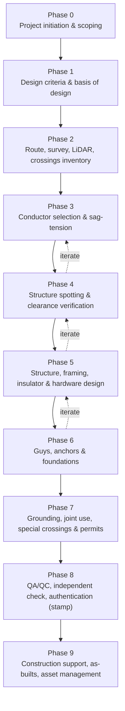

Each phase below lists: **Objective → Code touchpoints → Inputs → Outputs → Pain points → Automation opportunities**.

---

### Phase 0 — Project initiation & scoping

| Aspect | Detail |
|---|---|
| Objective | Define facility type, voltage, circuits, jurisdiction, owner, schedule, code path |
| Code touchpoints | C22.3 No. 1 scope/definitions; jurisdictional adoption; decision on No. 60826 |
| Inputs | Client scope, system studies (load flow, fault levels), route corridor, owner standards |
| Outputs | Project charter, applicable-codes register, design-path decision |
| Pain points | Wrong edition used; missed provincial amendments; owner standard conflicts discovered late |
| Automation | **Project setup wizard**: location + voltage + owner → auto-generated *Applicable Codes & Standards Register* with adopted editions and overlays; flags conflicts |

### Phase 1 — Design criteria & basis of design (the most code-intensive phase)

| Aspect | Detail |
|---|---|
| Objective | Produce the **Design Criteria Document (DCD)** that governs every downstream calc |
| Code touchpoints | No. 1 loading map & conditions, construction grade, OCFs, tension limits, clearance conditions; No. 60826 reliability level, climatic data, wind/ice/combined loads, security & safety loads, strength factors |
| Inputs | Coordinates/route, elevation, terrain, historical climate (Canadian annex, NBCC, ECCC), owner experience (ice storms, galloping), conductor candidates |
| Outputs | DCD; load case matrix; temperature/tension limits; clearance criteria table with buffers; PLS-CADD criteria file |
| Pain points | Manual map reading; inconsistent load case naming; transcription errors into PLS-CADD; poor traceability |
| Automation | **Criteria Builder**: map click / KMZ import → loading zone(s), climatic values interpolated, return-period scaling, terrain-based factors → **auto load case matrix** (No. 1 + 60826 envelope) → export to `.cri`, SPIDAcalc, O-Calc; DCD auto-drafted with clause citations |

Typical DCD content checklist (see Appendix B for template): design code path & editions; reliability level; loading zone(s); weather cases (ice, wind, temp); construction grade by location; OCFs / strength factors; conductor tension limits (initial/final, every-day/H-w); clearance conditions and buffers; insulator swing cases; galloping criteria; security/containment; C&M loads; structure families; material standards.

### Phase 2 — Route, survey, LiDAR & crossings inventory

| Aspect | Detail |
|---|---|
| Objective | Build terrain model and identify every feature that drives clearances |
| Code touchpoints | No. 1 surface categories (roads, driveways, fields, rail, water, pedestrians-only areas), buildings/pools/signs, crossings with other utilities |
| Inputs | LiDAR point cloud, orthophoto, GIS (roads, rail, parcels, pipelines, water bodies), field reconnaissance |
| Outputs | Feature-coded terrain (PLS-CADD feature codes), crossings register, permits register |
| Pain points | Classifying thousands of features by code category; missing crossings; inconsistent feature codes |
| Automation | **Feature-to-code-category mapper**: GIS/LiDAR classification → C22.3 surface category with required clearance auto-assigned; crossings register auto-generated with AHJ/permit requirements (rail, navigable water, highway, pipeline, aviation) |

### Phase 3 — Conductor selection & sag-tension

| Aspect | Detail |
|---|---|
| Objective | Select conductor/OHGW/OPGW and establish stringing tensions |
| Code touchpoints | No. 1 tension limits; No. 60826 conductor strength; ice/wind cases from DCD |
| Inputs | Ampacity requirement (IEEE 738), conductor library, ruling spans, creep, vibration limits (H/w) |
| Outputs | Sag-tension tables (initial/final, creep/load), stringing charts |
| Pain points | Re-running cases when criteria change; checking every limit manually |
| Automation | **Sag-tension engine** with automatic limit checks against DCD; "governing case" identification; stringing chart generator |

### Phase 4 — Structure spotting & clearance verification

| Aspect | Detail |
|---|---|
| Objective | Locate structures, verify every clearance and separation at every critical condition |
| Code touchpoints | No. 1 vertical clearances, horizontal clearances (blowout), crossings, midspan separations, clearances to structures; overlays/buffers |
| Inputs | Terrain model, structure families, sag-tension, DCD clearance table |
| Outputs | Plan & profile drawings, clearance report, crossing drawings |
| Pain points | Long clearance reports reviewed manually; voltage adders/buffers applied inconsistently |
| Automation | **Clearance compliance engine**: ingest PLS-CADD clearance/violation reports or computed catenaries → compare to effective requirement per feature → violations list with clause citation, margin and governing condition |

### Phase 5 — Structure, framing, insulator & hardware design

| Aspect | Detail |
|---|---|
| Objective | Confirm structural adequacy of poles/towers, crossarms, insulators and hardware |
| Code touchpoints | No. 1 grades & OCFs, strength of wood/steel/concrete, insulator & hardware strength factors, separations at structure; No. 60826 strength factors & coordination |
| Inputs | Load cases, structure geometry, material properties (CSA O15 etc.) |
| Outputs | Structure usage charts (allowable span/angle), pole class selection, framing drawings, insulator swing charts |
| Pain points | Iterating pole classes; usage chart regeneration; swing checks |
| Automation | **Pole/structure check calculators**, **usage-chart generator** (allowable wind/weight span vs line angle per structure family), **insulator swing calculator** with clearance envelopes |

### Phase 6 — Guys, anchors & foundations

| Aspect | Detail |
|---|---|
| Objective | Size guys, anchors and foundations |
| Code touchpoints | No. 1 guy/anchor strength factors, guy insulators & guards; No. 60826 foundation strength factors |
| Inputs | Structure reactions, geotechnical data, anchor products |
| Outputs | Guy/anchor schedule, embedment depths, foundation designs |
| Automation | **Guy & anchor calculator**, direct-embed calculator (with geotechnical inputs), auto-generated staking sheet entries |

### Phase 7 — Grounding, joint use, special crossings & permits

| Aspect | Detail |
|---|---|
| Objective | Complete grounding plan, joint-use attachment design, crossing approvals |
| Code touchpoints | No. 1 grounding & bonding, joint-use separations & climbing space; No. 6 (pipelines); external regs (rail, water, aviation) |
| Outputs | Grounding plan, attachment approvals, permit packages |
| Automation | **Joint-use attachment checker** (separation + pole loading in one pass), **permit package generator** with required drawings/clearance tables |

### Phase 8 — QA/QC, independent check, authentication

| Aspect | Detail |
|---|---|
| Objective | Independent review, resolution, stamping |
| Outputs | Checked calc package, comment log, stamped drawings/DCD |
| Pain points | Checker must re-derive inputs; no single trace from number → clause |
| Automation | **Calc trace & checker mode**: every output shows inputs, formula, clause, edition, overlay; checker signs off per item; immutable revision history |

### Phase 9 — Construction support, as-builts & asset management

| Aspect | Detail |
|---|---|
| Objective | RFIs, field changes, as-builts, life-cycle assessments (pole deterioration, uprating) |
| Code touchpoints | No. 1 strength of deteriorated structures/replacement criteria; clearance re-verification after changes |
| Automation | **Field mode** (offline clearance & loading lookup, measurement entry), **re-rating / uprating workflow** (new temp → re-check clearances), **residual-strength pole assessment** using inspection data |

---

### 5.2 Workflow variants (common engagement types)

| Variant | Typical frequency | Key code-driven steps | Highest-value automation |
|---|---|---|---|
| **D1 — Distribution pole-attachment application (telecom/joint use)** | Very high (thousands/yr) | Separation at structure & midspan, pole loading with new attachment, guying | Batch pole loading + separation check; auto approve/deny with reasons |
| **D2 — New distribution feeder / subdivision** | High | Loading zone, grade, clearances to ground/buildings, standard framing | Standard-unit design + auto clearance checks |
| **D3 — Pole replacement / storm hardening** | High | Strength, OCFs, deterioration | Rapid class selection, storm-hardening scenarios |
| **T1 — New transmission line** | Medium | Full Phase 0–9, No. 60826 + No. 1 envelope | Criteria builder, clearance engine, usage charts |
| **T2 — Line uprating (thermal)** | Medium | Higher max temp → clearances, sag | Batch re-check, mitigation suggestions (raise, re-sag, reconductor) |
| **T3 — Rebuild / reconductoring** | Medium | Loads change, structure re-check | Delta analysis vs existing |
| **X — Third-party proximity requests** (buildings, cranes, pipelines) | High | Clearances to buildings/structures, No. 6 | Quick proximity calculator + letter generator |

### 5.3 Example: Distribution pole-attachment flow (D1)

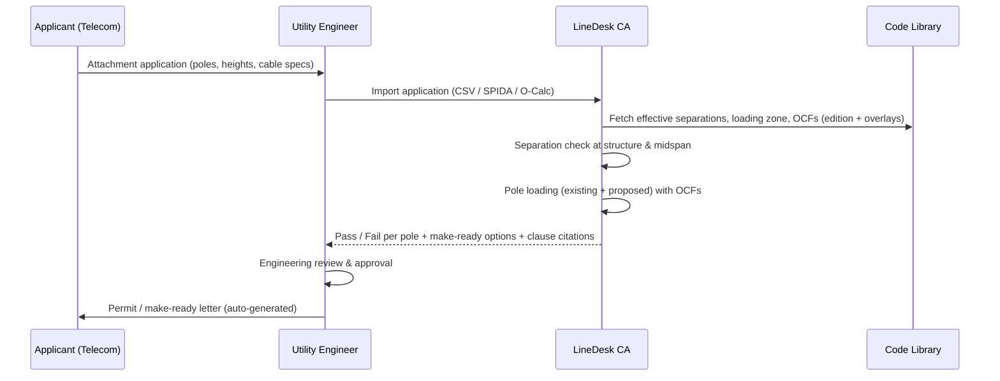

---

## 6. Core Engineering Calculation Library

All calculators share: **unit-aware inputs (SI primary, imperial display optional), validation ranges, explicit code-path tag (No. 1 / No. 60826 / both), and a calc-trace record**. Formulas below are standard engineering relations; code-specific coefficients come from the digitized library at runtime.

### 6.1 Weather & loading

**Dynamic wind pressure (general):**

$$q = \tfrac{1}{2}\,\rho\,V^2 \qquad (\rho = 1.225\ \text{kg/m}^3 \Rightarrow q \approx 0.613\,V^2\ [\text{Pa}],\ V\ \text{in m/s})$$

**No. 60826 dynamic reference pressure:**

$$q_0 = \tfrac{1}{2}\,\tau\,\mu\,(K_R\,V_R)^2$$

where τ = air density correction (temperature/altitude), μ = 1.225 kg/m³, K_R = terrain roughness factor, V_R = reference wind speed for the selected return period.

**Wind load on conductors (No. 60826 form):**

$$A_c = q_0 \cdot C_{xc} \cdot G_c \cdot G_L \cdot d \cdot L \cdot \sin^2\Omega$$

**Radial glaze ice weight per unit length** (ρ_ice = 900 kg/m³, t and d in mm):

$$w_{ice} = \rho_{ice}\, g\, \pi\, t\,(t + d) \times 10^{-6} \approx 0.02774\, t\,(t+d)\ \ [\text{N/m}]$$

**Iced diameter:** \( D = d + 2t \)

**Resultant unit load (deterministic, ice + wind):**

$$w_r = \sqrt{(w_c + w_{ice})^2 + (q\,D)^2}$$

(Any code-specified additive constant or temperature association must be applied per the adopted edition **[VERIFY]**.)

**Return-period scaling:** values from the Canadian annex for the base return period scaled to the selected reliability level using the code's conversion factors (table-driven, interpolated) **[VERIFY method per edition]**.

### 6.2 Sag-tension

| Relation | Formula |
|---|---|
| Ruling (equivalent) span | \( L_R = \sqrt{\dfrac{\sum L_i^3}{\sum L_i}} \) |
| Parabolic sag | \( S = \dfrac{w L^2}{8H} \) |
| Catenary sag | \( S = \dfrac{H}{w}\left[\cosh\!\left(\dfrac{wL}{2H}\right) - 1\right] \) |
| Conductor length (catenary) | \( \ell = \dfrac{2H}{w}\sinh\!\left(\dfrac{wL}{2H}\right) \) |
| Change of state | Strain summation: elastic + thermal + creep (initial/final, load-history), solved iteratively |
| Tension limit check | \( T_{max,case} \le k_{case} \cdot RTS \) with k from code/DCD |
| Vibration (every-day) | \( H/w \) (catenary parameter) vs CIGRE TB 273 limits |

### 6.3 Clearances & separations

| Calculation | Approach |
|---|---|
| Vertical clearance | Required = table value(voltage class, surface category) + voltage adder (if applicable) + owner buffer; Actual = conductor elevation at governing condition (max temp / ice) − ground/feature elevation |
| Horizontal clearance (blowout) | Conductor swing under code wind condition: \( \phi = \arctan\!\left(\dfrac{q\,D}{w_c + w_{ice}}\right) \); displaced position vs building/feature |
| Insulator swing | \( \theta = \arctan\!\left(\dfrac{q\,D\,L_{wind} + P_{ins}/2}{w\,L_{weight} + W_{ins}/2}\right) \) vs required air gap per swing case |
| Midspan separation | Code sag-dependent formula (voltage + sag terms) **[VERIFY]**, plus galloping ellipse checks where required by owner |
| Crossing separation | Upper line at max sag condition vs lower line at min sag condition; table requirement by both voltages |

### 6.4 Structures

| Calculation | Formula / method |
|---|---|
| Groundline moment (pole) | \( M_{GL} = \sum F_{c,i}\,h_i + F_{pole}\,\bar h + M_{P\Delta} \) |
| Wind on pole | \( F_{pole} = q\,C_d\,A_{proj} \) (tapered pole area) |
| Wood pole section modulus (from circumference C) | \( S = \dfrac{C^3}{32\pi^2} \) |
| Wood pole stress check | \( \text{OCF} \times M \le f_b \cdot S \) (deterministic) or \( \gamma_U M \le \Phi_R R_c \) (RBD) |
| Guy tension | \( T = \dfrac{H}{\sin\beta} \) (β = angle between guy and pole) × OCF ≤ rated strength × strength factor |
| Guyed pole buckling | Euler/Gere–Carter style tapered-column buckling check |
| Line-angle loads | \( F_{angle} = 2T\sin(\alpha/2) \) |
| Deadend / unbalanced | Longitudinal = full or residual tension per code case |
| Lattice / steel pole | Member/section checks per ASCE 10 / ASCE 48 / CSA S16 (export loads to PLS-TOWER/PLS-POLE) |

### 6.5 Foundations & anchors

Direct-embed depth (rule of thumb + geotechnical method, e.g., Brinch Hansen / Broms for lateral), anchor capacity from manufacturer data × strength factor, rock/soil class selection — always with geotechnical sign-off inputs.

---

## 7. Automation Strategy

### 7.1 Automation maturity levels

| Level | Name | Description | Example |
|---|---|---|---|
| L0 | Digital reading | Searchable licensed PDF | Today's baseline |
| L1 | Structured lookup | Clauses/tables as data, filters, cross-refs | "Show vertical clearance for 25 kV over a road" |
| L2 | Parametric calculators | Table lookups + formulas with trace | Wind/ice load, sag, swing, pole stress |
| L3 | Criteria generation | Project-level, multi-case generation & export | DCD + PLS-CADD criteria auto-generated |
| L4 | Compliance automation | Batch checking of models/reports against rules | Whole-line clearance & pole loading pass/fail |
| L5 | Assisted design | Optimization & recommendations with human approval | Suggest pole class/height, structure spotting optimization, mitigation options for violations |

### 7.2 Automation opportunities — value vs effort

| # | Automation | Value | Effort | Priority |
|---|---|---|---|---|
| A1 | Structured code library with search, cross-refs and edition switching | High | Medium | **MVP** |
| A2 | Clearance lookup with voltage adders & overlays | Very high | Low | **MVP** |
| A3 | Loading zone / climatic data lookup from map location | Very high | Medium | **MVP** |
| A4 | Load case matrix generator (No. 1 + No. 60826 envelope) | Very high | Medium | **MVP** |
| A5 | PLS-CADD criteria (.cri) / SPIDAcalc / O-Calc load case export | Very high | Medium–High | Phase 2 |
| A6 | Wood pole loading calculator with OCFs & CSA O15 data | High | Medium | **MVP** |
| A7 | Sag-tension engine with limit checks | High | High | Phase 2 |
| A8 | Clearance report ingestion & compliance engine | Very high | Medium | Phase 2 |
| A9 | Insulator swing & blowout calculators | Medium | Low | Phase 2 |
| A10 | Joint-use batch attachment checker | Very high (distribution) | Medium | Phase 2 |
| A11 | DCD and calc-package report generator with citations | High | Medium | Phase 2 |
| A12 | Usage chart generator per structure family | High | Medium | Phase 3 |
| A13 | Crossing register & permit package generator | Medium | Medium | Phase 3 |
| A14 | Edition diff & impact analysis ("what changes if we move to the new edition?") | High (standards groups) | Medium | Phase 3 |
| A15 | AI assistant: natural-language Q&A over licensed code with mandatory clause citations | High | Medium | Phase 3 |
| A16 | Mitigation recommender (raise structure, re-sag, reframe) | Medium | High | Phase 4 |
| A17 | Spotting optimization | Medium | Very high | Phase 4 (or rely on PLS-CADD Optimum Spotting) |

### 7.3 Automation principles

1. **Never hide the code.** Every automated value links to clause/table/edition and overlay.
2. **Human-in-the-loop for judgment.** Automation proposes; the engineer accepts, overrides (with mandatory reason), and signs.
3. **Deterministic & reproducible.** Same inputs + same library version ⇒ identical outputs (library snapshots pinned per project).
4. **Conservative defaults.** When data is ambiguous (e.g., point on loading-zone boundary), default to the more severe value and flag.
5. **Integrate, don't replace.** PLS-CADD, PLS-POLE/TOWER, SPIDAcalc, O-Calc remain the analysis engines; LineDesk generates their inputs and checks their outputs.
6. **AI is retrieval-grounded only.** Any LLM feature answers *only* from the licensed library, cites clauses, and refuses when not grounded.

---

## 8. The Digitized Code ("Code-as-Data")

### 8.1 Goals

- Faithful, versioned, machine-readable representation of each adopted edition.
- Tables are **queryable data**, not images.
- Formulas are **executable expressions** with units.
- Cross-references are **links** (graph).
- Overlays (jurisdiction, owner, project) are **separate layers**, never edits to the base.
- Every record carries **provenance** (edition, amendment, page, entered by, verified by, date).

### 8.2 Data model

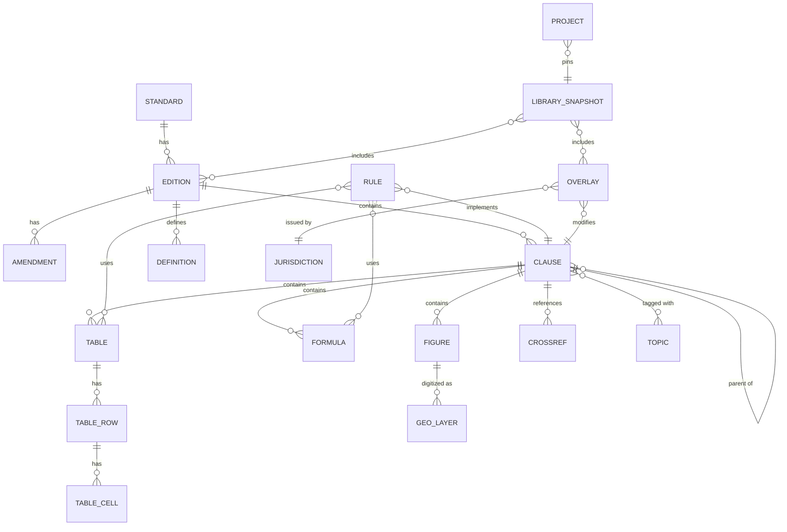

### 8.3 Record schemas (illustrative)

**Clause**

```json
{
  "id": "C22.3-1:2020/5.x.x",
  "standard": "CSA C22.3 No. 1",
  "edition": "2020",
  "amendment": null,
  "number": "5.x.x",
  "title": "Vertical clearances of conductors above ground or rails",
  "text_licensed": "<licensed clause text — only if license permits>",
  "intent_summary": "Sets minimum vertical clearance of conductors above ground/rails by voltage and surface category under specified sag conditions.",
  "normative": true,
  "topics": ["clearance.vertical", "crossing.road", "crossing.rail"],
  "applies_to": { "facility": ["supply", "communication"], "voltage_kV": [0, 1000] },
  "tables": ["C22.3-1:2020/T-clearance-vertical"],
  "formulas": [],
  "cross_refs": ["C22.3-1:2020/5.y (sag conditions)", "C22.3-1:2020/3 (definitions: 'crossing')"],
  "provenance": { "page": 0, "entered_by": "jdoe", "verified_by": "asmith_peng", "verified_on": "2026-xx-xx" },
  "status": "VERIFIED"
}
```

**Table (queryable)**

```yaml
id: C22.3-1:2020/T-clearance-vertical
title: Minimum vertical clearance above ground or rails
dimensions:
  - key: surface_category       # e.g., highway, road, driveway, field, rail, pedestrian-only, water
    type: enum
  - key: voltage_class          # e.g., comm, 0-0.75kV, 0.75-22kV, 22-50kV, ...
    type: range_kV
value:
  key: clearance
  unit: m
interpolation: none             # none | linear | step
adders:
  - rule_id: R-VADDER-01        # voltage adder above a threshold [VERIFY]
rows:
  - { surface_category: road, voltage_class: "0.75-22", clearance: "<VALUE> [VERIFY]" }
notes:
  - "Applies at the governing sag condition defined in clause 5.y [VERIFY]"
status: DRAFT
```

**Formula (executable)**

```yaml
id: C22.3-60826/F-q0
expression: "0.5 * tau * mu * (K_R * V_R)^2"
variables:
  tau: { unit: "1", source: "table:air_density_correction" }
  mu:  { unit: "kg/m^3", default: 1.225 }
  K_R: { unit: "1", source: "table:terrain_roughness" }
  V_R: { unit: "m/s", source: "input|climatic_data" }
result: { symbol: q0, unit: "Pa" }
tests:
  - inputs: { tau: 1.0, mu: 1.225, K_R: 1.0, V_R: 30 }
    expected: 551.25
    tolerance: 0.01
```

**Rule (rules-as-code)**

```yaml
id: R-CLR-VERT-001
title: Vertical clearance to ground/feature
implements: C22.3-1:2020/5.x.x
inputs: [voltage_kV, surface_category, conductor_elevation_m, feature_elevation_m, condition]
logic: |
  required = lookup(T-clearance-vertical, surface_category, voltage_class(voltage_kV))
           + adder(R-VADDER-01, voltage_kV)
           + overlay_buffer(owner, "clearance.vertical")
  actual   = conductor_elevation_m - feature_elevation_m
  pass     = actual >= required
outputs: [required, actual, margin = actual - required, pass]
severity_on_fail: VIOLATION
citation_format: "{standard} {edition} cl. {clause}, {table} row {row}"
```

**Overlay**

```yaml
id: OVL-UTILITYX-CLR-BUF
issuer: "Utility X Distribution Standards"
type: owner
mode: restrict              # restrict = add/take max ; replace = supersede (needs justification)
target: "topic:clearance.vertical"
change: { add_m: 0.30 }
justification: "Survey/model accuracy & future re-sag buffer"
effective: 2026-01-01
```

### 8.4 Topic taxonomy (tagging)

```
loading.zone | loading.ice | loading.wind | loading.temperature | loading.combined
loading.security | loading.safety | loading.longitudinal
strength.ocf | strength.grade | strength.wood | strength.steel | strength.concrete
strength.guy | strength.anchor | strength.insulator | strength.hardware | strength.foundation
conductor.tension_limit | conductor.sag_condition | conductor.vibration
clearance.vertical | clearance.horizontal | clearance.building | clearance.pool
clearance.sign | clearance.bridge | clearance.structure | clearance.water | clearance.rail
separation.same_structure | separation.midspan | separation.crossing | separation.comm_supply
grounding | bonding | jointuse | equipment | definitions
```

### 8.5 Figures & maps

- **Loading map** digitized into a **GIS polygon layer** (GeoJSON / vector tiles) with zone attribute and edition. Boundary uncertainty buffer (e.g., ±X km) triggers a "near boundary — conservative zone applied" flag.
- **Climatic data tables** (Canadian annex, NBCC) stored as point datasets with spatial interpolation rules exactly as the code/user-approved method prescribes (nearest station vs. interpolation must be an explicit, recorded choice).
- Figures that are diagrams (e.g., clearance envelopes) are stored as SVG with parametric overlays.

### 8.6 Digitization pipeline

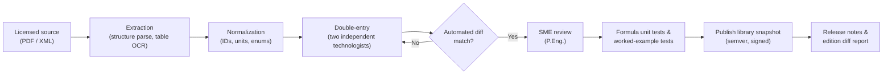

**Quality gates:** 100 % double-entry match for tables; every formula has ≥ 2 test vectors; every rule has pass/fail test cases; SME sign-off recorded per clause; snapshot is immutable and hash-signed.

### 8.7 Edition & amendment management

- Each edition is a separate namespace (`C22.3-1:2015`, `C22.3-1:2020`, …).
- Clause **lineage links** (`supersedes`, `renumbered_from`) enable automatic **edition diff** reports: changed values, new clauses, deleted clauses, and **projects impacted**.
- Projects pin a **library snapshot**; upgrading a project is an explicit action producing an impact report.

### 8.8 Reference UI for the digitized code

| Feature | Description |
|---|---|
| Clause browser | Tree navigation, breadcrumbs, normative/informative badges |
| Smart search | Full-text + topic facets + voltage/surface filters + synonyms ("ground clearance" → clearance.vertical) |
| Interactive tables | Pick dimensions → highlighted cell → "Use in calculator" |
| Live formulas | Rendered math + inline calculator + unit switching |
| Cross-ref graph | Hover previews, "referenced by" panel |
| Definitions | Inline tooltips on defined terms |
| Overlay view | Toggle base ↔ effective (with jurisdiction/owner deltas highlighted) |
| Edition compare | Side-by-side with changes highlighted |
| Annotations | Personal and team notes, interpretations, RFI/AHJ responses linked to clauses |
| Bookmarks & "cheat sheets" | Custom quick-reference cards (e.g., "25 kV distribution clearances, Utility X") exportable to PDF for field use |

---

## 9. The App — "LineDesk CA"

### 9.1 Personas

| Persona | Goals | Key modules |
|---|---|---|
| **Transmission design engineer (P.Eng.)** | Fast, defensible criteria; envelope load cases; clean PLS-CADD inputs | Criteria Builder, Code Library, Compliance, Reports |
| **Distribution design technologist** | Rapid standard designs, pole loading, clearances | Calculators, Pole Loading, Joint Use |
| **Joint-use / attachments engineer** | Process high volume of attachment applications | Batch Joint-Use Checker |
| **Checker / reviewer** | Verify inputs and citations quickly | Checker Mode, Calc Trace |
| **Standards engineer (utility)** | Maintain overlays, evaluate new editions | Overlay Manager, Edition Diff |
| **Field engineer / inspector** | Offline lookups, measurements, RFIs | Field Mode (mobile) |

### 9.2 Product principles

1. Workflow-first navigation (mirrors Phases 0–9).
2. Every number is clickable → shows its trace.
3. Offline-capable reference and calculators.
4. Import/export with industry tools is first-class.
5. Audit trail by default.

### 9.3 Module map

```mermaid
flowchart TD
    subgraph Reference
        R1["Code Library"]
        R2["Overlay Manager"]
        R3["Edition Diff"]
        R4["AI Code Assistant (cited)"]
    end
    subgraph Project
        P1["Project Setup Wizard"]
        P2["Criteria Builder"]
        P3["Crossings & Features Register"]
        P4["Structure Families & Usage Charts"]
    end
    subgraph Calculate
        C1["Weather & Load Calculators"]
        C2["Sag-Tension"]
        C3["Clearance & Separation"]
        C4["Pole / Structure Loading"]
        C5["Guys, Anchors, Foundations"]
        C6["Insulator Swing & Blowout"]
    end
    subgraph Verify
        V1["Compliance Engine"]
        V2["Joint-Use Batch Checker"]
        V3["Checker Mode"]
    end
    subgraph Deliver
        D1["Reports (DCD, Calc Package)"]
        D2["Exports (.cri, SPIDA, O-Calc, CSV, KMZ)"]
        D3["Permit Packages"]
    end
    subgraph Field
        F1["Offline Lookup"]
        F2["Measurement & Photo Capture"]
    end
    Reference --> Project --> Calculate --> Verify --> Deliver
    Reference --> Field
```

### 9.4 Module specifications

#### M1 — Project Setup Wizard

| Step | Inputs | System actions | Output |
|---|---|---|---|
| 1. Basics | Name, client/owner, facility type (T/D/joint), voltage(s), circuits | Validate | Project record |
| 2. Location | Map draw / KMZ / shapefile of route | Determine province(s), loading zone(s), climatic stations, terrain hints | Location profile |
| 3. Code path | Suggested (No. 1 / No. 60826 / envelope), editable | Pull adopted editions & overlays | Applicable Codes Register |
| 4. Owner standards | Select owner overlay | Merge overlay | Effective rule set |
| 5. Snapshot | Confirm | Pin library snapshot | Project ready |

#### M2 — Criteria Builder

- **Weather panel:** loading zone(s) per segment; No. 60826 reliability level; V_R, ice, temperatures (source shown: annex station, NBCC, ECCC, owner study); return-period conversion; terrain category per segment; altitude correction.
- **Load case matrix:** auto-generated rows (No. 1 cases + No. 60826 climatic, security, safety cases), columns: ice, wind, temp, OCFs / load factors, strength factors, applicable components. Engineer can add/disable with reason.
- **Tension limits & sag conditions:** per conductor type and condition.
- **Clearance criteria table:** per feature category and voltage — base + adder + owner buffer = design value.
- **Outputs:** DCD (DOCX/PDF), `.cri` / criteria export, JSON for API.

Example generated load case matrix (illustrative):

| ID | Source | Description | Ice (mm) | Wind | Temp (°C) | Factors | Use |
|---|---|---|---|---|---|---|---|
| N1-HVY | No. 1 | Zone loading (e.g., Heavy) | 12.5 [VERIFY] | 400 Pa [VERIFY] | −20 | OCF by grade/material | Strength |
| N1-MAXT | No. 1 | Max conductor temperature | 0 | 0 | T_max (rating) | — | Vertical clearance |
| N1-ICE | No. 1 | Ice-loaded sag | per zone | 0 | per edition | — | Vertical clearance |
| N1-BLOW | No. 1 | Wind displacement | 0 | per edition | per edition | — | Horizontal clearance |
| R-W | 60826 | Reliability wind (T yr) | 0 | q0(V_R,T) | coincident | γ_U, Φ_R | Strength |
| R-I | 60826 | Ice without wind (T yr) | t_T | 0 | −5 typ. [VERIFY] | γ_U, Φ_R | Strength |
| R-IW1 | 60826 | Low-prob ice + high-prob wind | t_T | reduced V | coincident | γ_U, Φ_R | Strength |
| R-IW2 | 60826 | High-prob ice + low-prob wind | reduced t | V_iH | coincident | γ_U, Φ_R | Strength |
| R-UI | 60826 | Unbalanced ice | per code | 0 | — | — | Longitudinal |
| R-SEC | 60826 | Security: broken conductor / RSL | — | — | — | — | Containment |
| R-CM | 60826 | Construction & maintenance | — | — | — | safety factors | Safety |

#### M3 — Calculators (stand-alone or project-linked)

| Calculator | Inputs | Outputs | Code links |
|---|---|---|---|
| Weather load | Location, return period, terrain, height, conductor d | q0, ice t, g_R, iced D, resultant loads per case | No. 60826 wind/ice; No. 1 loading table |
| Clearance lookup | Voltage, surface/feature type, condition, owner | Required clearance with breakdown | No. 1 clearance tables + overlays |
| Separation | Voltages, sag, span, configuration | Required separation at structure & midspan | No. 1 separation tables/formula |
| Sag-tension | Conductor, spans, criteria, creep | Sag/tension tables, governing limit | No. 1 tension limits; DCD |
| Pole loading | Pole species/class/height, embedment, attachments, guys, angle, zone | Groundline moment, % utilization, required class | No. 1 OCFs/grade; CSA O15 |
| Guy & anchor | Pole reactions, geometry, soil | Guy size/count, anchor type, utilization | No. 1 guy/anchor rules |
| Insulator swing | Wind/weight spans, insulator data, cases | Swing angles, clearance envelope plot | No. 1 / owner swing cases |
| Blowout | Conductor, span, wind case | Horizontal displacement, clearance to building | No. 1 horizontal clearance |
| Crossing | Upper/lower line data | Separation required vs actual | No. 1 crossing tables |
| Galloping (owner criteria) | Conductor, span, sag | Ellipse dimensions & phase interference | Owner / CIGRE method |

Every calculator screen layout:

```
┌──────────────────────────────────────────────────────────────────────┐
│ Clearance Lookup                     Project: 138 kV Line A  [Snap v3]│
├──────────────────────┬───────────────────────────────────────────────┤
│ INPUTS               │ RESULT                                         │
│ Voltage: 138 kV L-L  │ Required vertical clearance:  X.XX m           │
│ Feature: Road        │  ├ Base (Table T-x, row r)    X.XX m  [cite]   │
│ Condition: Max temp  │  ├ Voltage adder (cl. y)      0.XX m  [cite]   │
│ Owner: Utility X     │  └ Owner buffer (OVL-…)       0.30 m  [cite]   │
│                      │ Actual (from model):          Y.YY m           │
│ [Use model value]    │ Margin:                       +Z.ZZ m   ✅ PASS │
├──────────────────────┴───────────────────────────────────────────────┤
│ TRACE ▸ inputs ▸ formula ▸ clause text ▸ edition ▸ overlay ▸ user    │
│ [Add to calc package]  [Export PDF]  [Open clause]                   │
└──────────────────────────────────────────────────────────────────────┘
```

#### M4 — Compliance Engine

- **Inputs:** PLS-CADD clearance/violation reports, structure usage reports, PLS-POLE/TOWER results, SPIDAcalc/O-Calc results, CSV/LAS-derived clearance tables.
- **Processing:** map each record to feature category & condition → resolve effective rule → evaluate → classify (PASS / MARGINAL (< buffer) / VIOLATION / NEEDS-DATA).
- **Outputs:** interactive table + map/profile view; filter by severity, rule, structure; export clearance report with citations; open-issues list synced to checker comments.

#### M5 — Joint-Use Batch Checker (distribution)

- Bulk import of applications (CSV/SPIDA/O-Calc JSON).
- For each pole: separations (supply ↔ comm, comm ↔ comm, climbing space), midspan sag separations, pole loading with new attachment, guying adequacy.
- Auto-generated make-ready scope (raise, lower, transfer, replace pole with class/height).
- Approval letter templates with clause citations.

#### M6 — Reports & Deliverables

| Report | Contents |
|---|---|
| Design Criteria Document | Auto-drafted from Criteria Builder, clause citations, overlay table, revision block |
| Calculation package | Selected calculations with full trace, cover sheet, checker sign-off |
| Clearance report | Compliance engine results by span/feature |
| Pole loading report | Per pole utilization, governing case |
| Crossing/permit package | Crossing drawings data, clearance tables, AHJ-specific forms |
| Codes register | Applicable standards, editions, amendments, overlays |

#### M7 — Checker Mode

- Side-by-side "designer value vs checker independent value" for spot-checks.
- Item-level status: Not checked / Agreed / Comment / Resolved.
- Locks the revision once approved; stamps metadata (who/when/snapshot hash).

#### M8 — Field Mode (mobile, offline)

- Offline cache of effective clearance tables for selected owner/edition.
- Quick calculators (clearance required, pole class check, guy check).
- Measurement entry (laser rangefinder heights, temperature at time of measurement) → **temperature-corrected sag** projection to max-temp condition → pass/fail.
- Photo + GPS capture linked to structure IDs; RFI creation.

#### M9 — AI Code Assistant (Phase 3)

- Retrieval-augmented over licensed library only; answers include clause IDs and edition; shows retrieved passages; refuses ungrounded answers; logs every Q&A for audit.
- Example: *"What's the governing horizontal clearance for a 25 kV line beside a 3-storey building under wind displacement for Utility X?"* → answer with table/row/overlay citations and a link to open the Blowout calculator pre-filled.

### 9.5 Key user flow — New transmission line criteria (T1)

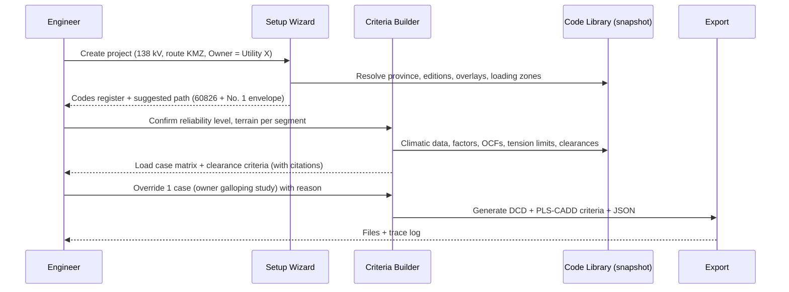

### 9.6 Non-functional requirements

| Category | Requirement |
|---|---|
| Accuracy | Calculators match benchmark cases within stated tolerance (e.g., ≤ 0.5 % or code rounding rules) |
| Traceability | 100 % of computed outputs have a trace record |
| Performance | Lookup < 200 ms; batch of 1,000 poles < 2 min; 100 km line clearance report ingestion < 1 min |
| Availability | Offline reference & calculators; cloud sync when online |
| Security | SSO (Azure AD/Entra), role-based access, license-entitlement gating of licensed text |
| Audit | Immutable logs of overrides, approvals, snapshot changes |
| Units | SI primary; imperial display; no mixed-unit storage |
| Accessibility | WCAG 2.2 AA for web UI |
| Data residency | Canadian hosting option (common utility requirement) |

---

## 10. System Architecture

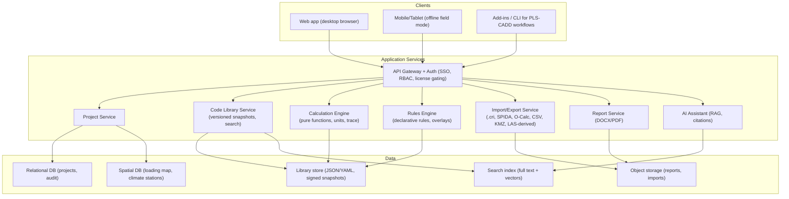

### 10.1 Recommended technology choices (adaptable)

| Layer | Recommendation | Rationale |
|---|---|---|
| Calculation core | **Single shared library** (e.g., TypeScript or Python) with a units library; pure, side-effect-free functions | Same results on web, mobile and server; easy testing |
| Rules | Declarative YAML/JSON rules evaluated by a small interpreter (or JSON-Logic/CEL) | SMEs can review rules without reading code |
| Library storage | Git-backed YAML/JSON → compiled, signed snapshot bundles | Diffable, reviewable, versioned |
| Spatial | PostGIS + vector tiles | Loading map and climatic station lookup |
| Search | Full-text + vector index (licensed text only, entitlement-filtered) | Smart search & AI grounding |
| Frontend | Modern web SPA + PWA offline; optional cross-platform mobile | Desk + field coverage |
| Reports | Templated DOCX/PDF generation | Owner templates, stampable |
| Hosting | Canadian region cloud or on-prem option | Utility data residency |

### 10.2 Calculation trace record

```json
{
  "calc_id": "c-2026-000123",
  "calculator": "clearance.vertical",
  "library_snapshot": "LIB-2026.03-sha256:…",
  "inputs": { "voltage_kV": 138, "surface_category": "road", "condition": "max_temp" },
  "steps": [
    { "op": "lookup", "ref": "C22.3-1:2020/T-x row r", "value": "X.XX m" },
    { "op": "adder", "ref": "R-VADDER-01", "value": "0.XX m" },
    { "op": "overlay", "ref": "OVL-UTILITYX-CLR-BUF", "value": "0.30 m" }
  ],
  "result": { "required_m": "…", "actual_m": "…", "margin_m": "…", "status": "PASS" },
  "user": "engineer@utility", "timestamp": "2026-10-12T18:20:00-05:00",
  "overrides": []
}
```

---

## 11. Verification, Validation & Quality Management

### 11.1 Test strategy

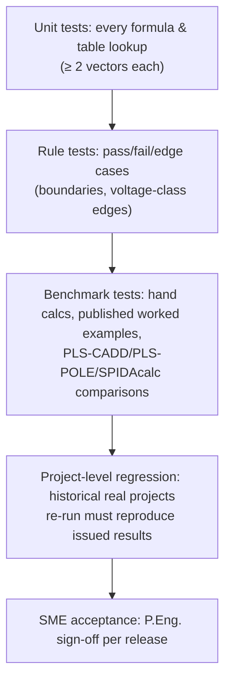

### 11.2 Quality controls

| Control | Description |
|---|---|
| Library verification | Double-entry + SME sign-off per clause/table; signed snapshots |
| Software change control | Every release has release notes, test evidence and impact report |
| Edition change control | New edition → diff report → impacted projects list → re-validation |
| Override governance | Overrides require reason, are highlighted in reports, and are reviewed in Checker Mode |
| Independent check | Checker Mode enforces documented independent review before "Issued" status |
| Regulator alignment | Align with provincial guidance on use of engineering software, documented checks and authentication |
| Disclaimers | Visible in reports: tool version, snapshot, responsible engineer |

---

## 12. Roadmap & Delivery Plan

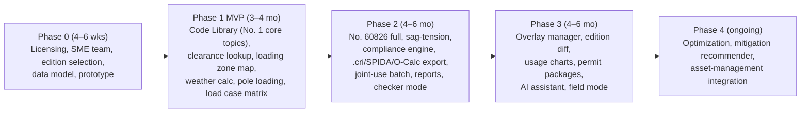

### 12.1 MVP scope (Phase 1)

| Included | Excluded (later) |
|---|---|
| C22.3 No. 1: loading conditions & map, construction grades, OCFs, vertical/horizontal clearances, building clearances, same-structure separations, tension limits | Full 60826 security/safety module |
| Clearance lookup calculator with owner overlay (one owner) | Multi-owner overlay manager |
| Weather load calculator (No. 1 + basic 60826 wind/ice) | Full return-period statistics tools |
| Wood pole loading calculator (CSA O15 classes) | Steel/lattice member checks (export to PLS) |
| Load case matrix (view + CSV export) | Direct `.cri` export |
| Project setup + snapshot pinning + trace | Compliance engine ingestion |

### 12.2 Team

| Role | FTE (indicative) |
|---|---|
| Product owner (senior line engineer, P.Eng.) | 0.5–1.0 |
| SME reviewers (T&D P.Eng.) | 1–2 (part-time pool) |
| Code digitization technologists | 2 |
| Software engineers (calc core, backend, frontend) | 3–4 |
| QA / test engineer | 1 |
| UX designer | 0.5 |

### 12.3 Success metrics

| KPI | Target |
|---|---|
| Time to produce DCD | −50 % |
| Time per pole-attachment application | −60 % |
| Clearance-check review time per 10 km | −40 % |
| Post-issue non-conformances attributable to code lookup errors | → 0 |
| % outputs with complete trace | 100 % |
| Engineer adoption (weekly active) | > 70 % of target users at 6 months |

---

## 13. Risks & Mitigations

| Risk | Impact | Likelihood | Mitigation |
|---|---|---|---|
| CSA licensing does not permit text embedding | High | Medium | Store IDs, paraphrased intent and user-verified values; deep-link to licensed copy; negotiate enterprise license early |
| Digitization error in a table value | Very high | Medium | Double entry, SME sign-off, tests, signed snapshots, "VERIFIED" status gating |
| Wrong edition/jurisdiction applied | High | Medium | Mandatory codes register, project snapshot pinning, jurisdiction resolver |
| Over-reliance on automation | High | Medium | Trace UI, checker mode, overrides highlighted, training |
| Integration formats change (PLS, SPIDA, O-Calc) | Medium | Medium | Adapter layer, versioned parsers, vendor partnerships |
| AI hallucination | High | Medium | RAG-only, citation required, refusal policy, logging, disabled for normative decisions |
| Scope creep into full FEA/structural analysis | Medium | High | Clear boundary: generate inputs/check outputs of established tools |
| Loading-zone boundary ambiguity | Medium | Medium | Boundary buffer + conservative default + flag |

---

## 14. Appendices

### Appendix A — Glossary

| Term | Meaning |
|---|---|
| AHJ | Authority having jurisdiction |
| Blowout | Horizontal conductor displacement under wind |
| Construction grade | C22.3 No. 1 classification setting strength requirements (e.g., Grade 1 / Grade 2) |
| DCD | Design Criteria Document (basis of design) |
| Envelope approach | Designing for the governing result of multiple code paths |
| H/w | Catenary parameter (horizontal tension / unit weight) used for vibration control |
| OCF | Overload Capacity Factor (deterministic load multiplier) |
| OPGW / OHGW | Optical ground wire / overhead ground wire |
| RBD | Reliability-based design (C22.3 No. 60826) |
| RSL | Residual static load (security case) |
| RTS | Rated tensile strength |
| Ruling span | Equivalent span representing a tension section |
| Snapshot | Immutable, signed version of the code library + overlays pinned to a project |
| Usage chart | Allowable wind span / weight span vs line angle diagram for a structure type |

### Appendix B — Design Criteria Document (DCD) template (auto-generated sections)

1. Project description (facility, voltage, circuits, route, owner)
2. Applicable codes, standards & regulations (editions, amendments, overlays)
3. Design path (No. 1 / No. 60826 / envelope) and justification
4. Reliability level & return periods (if 60826)
5. Climatic data (sources, stations, interpolation method, altitude/terrain adjustments)
6. Loading zone(s) and deterministic loading conditions
7. Load case matrix (climatic, security, safety, construction, deterministic)
8. Load / overload capacity factors and strength factors by component
9. Conductor & shield wire data; tension limits; vibration criteria; creep assumptions
10. Clearance criteria table (base + adders + buffers) and governing conditions
11. Separation criteria (structure & midspan), galloping criteria
12. Insulator swing cases and air gaps
13. Structure families, materials and standards (CSA O15, S16, etc.)
14. Guying, anchoring and foundation criteria
15. Grounding & bonding criteria
16. Joint-use criteria
17. Special crossings & permits (rail, navigable water, highways, pipelines, aviation)
18. Deviations, overrides & interpretations (with justification)
19. Revision history & authentication block

### Appendix C — Phase checklists (condensed)

**Phase 1 — Criteria**
- [ ] Adopted edition(s) confirmed for jurisdiction
- [ ] Owner overlay version recorded
- [ ] Loading zone(s) verified incl. boundary proximity
- [ ] Climatic sources documented; return period conversion recorded
- [ ] Terrain categories assigned per segment
- [ ] Construction grade(s) assigned (crossings, voltage, location)
- [ ] Tension limits and vibration criteria set
- [ ] Clearance criteria table with buffers issued
- [ ] Security & C&M cases defined (60826)
- [ ] Criteria exported and import into PLS-CADD verified

**Phase 4 — Spotting & clearances**
- [ ] All crossings in register modeled with correct feature codes
- [ ] Max-temp, ice-loaded and blowout conditions checked
- [ ] Midspan and crossing separations checked
- [ ] Marginal items (within buffer) reviewed
- [ ] Clearance report generated with citations

**Phase 5/6 — Structures, guys, foundations**
- [ ] All load cases applied to each structure type
- [ ] Usage charts confirm every structure within limits
- [ ] Insulator swing clearances verified
- [ ] Guys/anchors sized and guy insulators/guards per code
- [ ] Foundations designed with geotechnical inputs

**Phase 8 — QA**
- [ ] Independent check completed in Checker Mode
- [ ] Overrides reviewed and justified
- [ ] Library snapshot & software version recorded
- [ ] Authentication (stamp) applied

### Appendix D — Sample rules catalogue (initial set)

| Rule ID | Topic | Description |
|---|---|---|
| R-CLR-VERT-001 | clearance.vertical | Conductor-to-ground/feature vertical clearance |
| R-CLR-HORZ-001 | clearance.horizontal | Wind-displaced conductor to building/structure |
| R-CLR-POOL-001 | clearance.pool | Clearances over/near swimming pools |
| R-SEP-STR-001 | separation.same_structure | Phase/circuit/supply–comm separation at structure |
| R-SEP-MID-001 | separation.midspan | Sag-dependent midspan separation |
| R-SEP-XING-001 | separation.crossing | Line-crossing vertical separation |
| R-TEN-001 | conductor.tension_limit | Max tension per condition vs % RTS |
| R-STR-WOOD-001 | strength.wood | Wood pole groundline utilization with OCF |
| R-STR-GUY-001 | strength.guy | Guy tension with OCF vs rated strength |
| R-INS-001 | strength.insulator | Insulator mechanical load vs rating factor |
| R-JU-001 | jointuse | Supply–comm separation & climbing space |
| R-RBD-001 | loading.* | γ_U·Q_T ≤ Φ_R·R_c component check |

### Appendix E — Items requiring SME verification before production

| # | Item | Source to verify |
|---|---|---|
| 1 | Adopted edition of C22.3 No. 1 and No. 60826 per province/territory | Provincial regulations / AHJ |
| 2 | Loading conditions table values (all zones) and loading map boundaries | C22.3 No. 1 (adopted edition) |
| 3 | Construction grade criteria and OCF tables | C22.3 No. 1 |
| 4 | All clearance and separation tables, voltage adders, sag conditions | C22.3 No. 1 |
| 5 | Conductor tension limits | C22.3 No. 1 |
| 6 | Reliability levels / return periods and Canadian deviations | C22.3 No. 60826 |
| 7 | Canadian climatic data annex values and conversion factors | C22.3 No. 60826 |
| 8 | Wind factors (K_R, G_c, G_L, G_t, C_x), ice combination factors | C22.3 No. 60826 |
| 9 | Strength factors (Φ_N, Φ_Q, Φ_S, Φ_C) and coordination rules | C22.3 No. 60826 |
| 10 | Wood pole fibre stresses, dimensions, classes | CSA O15 |
| 11 | Insulator & hardware rating factors | C22.3 No. 1, CSA C411.1, CSA C83 |
| 12 | Owner overlays (buffers, stricter values) | Utility standards |

---

*End of document.*
